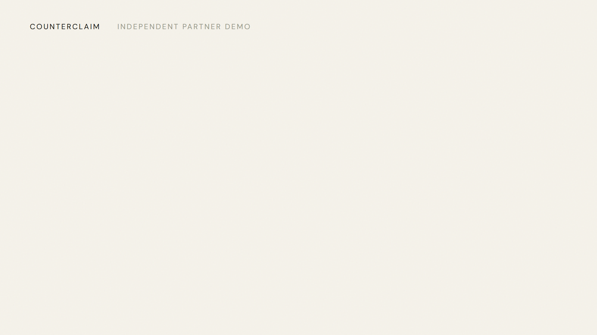

<p align="center">
  
  &nbsp;&nbsp;×&nbsp;&nbsp;
  
  &nbsp;&nbsp;×&nbsp;&nbsp;
  <picture><source media="(prefers-color-scheme: dark)" srcset="media/assets/genlayer-logo-white.svg" /></picture>
</p>

# Counterclaim

**Disagree on the delivery. Agree on what happens next.**

A working Yellow × GenLayer integration using Internet Court's agreement-and-evidence
pattern for the disagreement path in agent-to-agent work. Two synthetic agents freeze their agreement, a real
GenLayer contract reviews the supplied artifacts, and both agents co-sign the
same receipt-bound outcome in a real Yellow sandbox session.

[Watch the 42-second film](demo/counterclaim.mp4) ·
[Inspect the real result](LIVE-RESULTS.md) ·
[Follow the architecture](ARCHITECTURE.md) ·
[Original Partner Demo Lab brief](https://portal.genlayer.foundation/mission/101) ·
[Projects submission record](docs/PROJECT-SUBMISSION.md)



## The case

The seller says the release is complete. The buyer says the tests are missing.
The agreed delivery has three weighted milestones:

| Deliverable | Demo credits | Artifact supplied in this fictional handoff |
| --- | ---: | --- |
| Landing page | 40 | A complete draft meeting its agreed scope. |
| Integration guide | 35 | A complete guide including prerequisites and failure paths. |
| Automated tests | 25 | A status note promising tests later, rather than executable tests. |

The contract must judge each artifact against its **own full natural-language
acceptance criteria**. It does not count files or take the seller's completion
claim as proof. In the recorded run, the persisted consensus result accepted the
first two milestones and rejected the third. Contract code derived **75 seller /
25 buyer demo credits** from the frozen weights.

These supplied case artifacts are separate from this repository's own automated
test suite. The scenario is deliberately synthetic and reproducible.

## What actually runs

- **Yellow SDK 1.4.0:** real sandbox sessions, two isolated signer processes,
  unanimous signatures, versioned updates, live read-back and closure.
- **CounterclaimCourt:** a real deployed GenLayer Intelligent Contract with
  immutable case inputs, full independent receipt validation, bounded technical
  retries and a consequential resolved/inconclusive state.
- **Cooperative relay:** independently re-reads the persisted ruling and verifies
  the exact finalized `adjudicate(case_id)` transaction, caller, target and return
  payload before the proposal can be co-signed.
- **Interface:** inspect the full criteria and artifacts, request a real ruling,
  then co-sign and close. It does not advance into success when an API fails.

Yellow permits at most **1024 UTF-8 bytes** in session data. Its signed metadata
therefore contains full-content SHA-256 commitments and a compact court reference,
not silently shortened evidence. Full inputs live in the GenLayer case and the
public proof. Every accepted Yellow state is read back and compared exactly.

### Deliberate boundary

The **100 demo credits are nonmonetary metadata**. All actual Yellow token
allocations are `[]`; there is no deposit, funded escrow, token payout or real
money movement. Both participants must still sign. A court ruling cannot override
a refusing Yellow participant, and Yellow node liveness is trusted.

GenLayer judges the supplied artifacts; it does not execute their code, authenticate
outside work or provide legal advice. The contract binds the declared Yellow
session but does not independently verify Yellow signatures inside GenVM. The
coordinator and RPC are explicit relay trust boundaries, not a trustless bridge.
This is an independent Partner Demo Lab demonstration.

## Run the real demo locally

Use **Node.js 24** and **Python 3.12+**. No personal wallet, private API key or
mainnet funds are required. The code creates fresh isolated test accounts. Never
put a real wallet key into this demo.

```sh
git clone https://github.com/zakazaka95/Counterclaim.git
cd Counterclaim
npm ci
npm --prefix server ci
npm --prefix app ci
npm run setup:genlayer
npm start
```

Keep that terminal running. In a second terminal:

```sh
cd Counterclaim
npm --prefix app run dev
```

Open **http://127.0.0.1:5178**:

1. Select **Open demo room**. Both test agents sign the agreement and evidence
   commitments into a real zero-token Yellow session.
2. Inspect the three artifacts. Select **Request a ruling**. The coordinator
   opens a matching immutable GenLayer case and waits for actual successful
   adjudication and finalization. This can take a few minutes.
3. Inspect the persisted outcome and Explorer link. An inconclusive ruling has no
   allocation and cannot enable the co-sign action.
4. Select **Co-sign & close room**. The persisted receipt is independently verified
   again; both agents sign the exact proposal, and the closed Yellow version is
   read back. Open **View the complete case timeline** to follow the record.

Alternatively, with the coordinator running and a fresh idle case, `npm run demo`
performs the same three live actions through the API. It does not simulate them.

The default GenLayer endpoint is `https://studio-dev.genlayer.com/api`, chain
**61997**. The runtime refuses another chain ID. A built-in Studio faucet supplies
only test GEN for network fees. Yellow uses
`wss://nitronode-sandbox.yellow.org/v1/ws`. These are development environments and
may be reset or unavailable; a failed call is not displayed as completed work.

### Fresh-clone and recovery behavior

Public `proof/` files are historical evidence, not signing configuration. A fresh
clone generates its own account and deploys its own matching court; it does not
need the original demonstrator's private keys. Active deployment and pending
transaction records stay in ignored `.local/` directories.

Known broadcasts are tracked by the exact operation identity, so retrying a wait
after a timeout resumes the same transaction instead of silently signing again.
Uncertain or failed reviews do not enable settlement. A failed review returns to
an actionable error state; users can retry the tracked operation or start another
zero-token case. If a proposal was applied but closure failed, a retry verifies
that same receipt and resumes closure rather than applying a second proposal.

If a remote update was accepted but its acknowledgement and local record were
lost, the adapter refuses to guess: inspect the live session before continuing.
No recovery path fabricates a signature, receipt or payout.

## Verify the code

```sh
python -m unittest discover -s tests -p test_counterclaim.py -v
npm test
npm --prefix server test
npm --prefix app test
npm --prefix app run build
```

The local suites cover 18 contract logic tests, 12 relay/transaction tests,
17 Yellow adapter tests and 6 UI model tests. They include full receipt-field
tampering, independent semantic disagreement, uncertainty, finality, wrong
transaction/case/caller, retries, authority, Unicode budgets and invalid signatures.
Controlled-output unit tests are separate from the observed live results in
[LIVE-RESULTS.md](LIVE-RESULTS.md); neither is a general AI accuracy benchmark.

The CI workflow runs these local checks without deploying or signing transactions.
The published contract's raw source fingerprint is recorded in `proof/deployment.json`.

## Rebuild the film

The editable Remotion project, official asset provenance, original audio stems,
immutable recorded proof and actual UI captures are in [media/](media/PRODUCTION.md).
All Remotion packages are pinned to the same version.

```sh
npm --prefix media ci
npm --prefix media run typecheck
npm --prefix media run dev
```

The render script uses an explicitly configured compatible headless Chrome; see
`media/PRODUCTION.md` and `media/scripts/render.mjs` for the local browser setting.
The film is 42 seconds, 1920×1080, 30 fps, with original music and sound design.
Chronological captures show the same recorded case and session; waiting is edited
down. All three required official marks are visible. The film never depicts a
funded transfer.

## Sources and licensing

The integration follows the public
[Internet Court skill](https://github.com/internet-court/internet-court-skill),
[Yellow settlement-room skill](https://github.com/layer-3/nitrolite/tree/main/agent-skills/yellow-settlement-room)
and [GenLayer documentation](https://docs.genlayer.com/developers/networks).

Original application, contract and adapter code is MIT licensed. Third-party
brands, typefaces and reused motion components retain their own rights and notices;
see [THIRD-PARTY-NOTICES.md](THIRD-PARTY-NOTICES.md). Logo use identifies the demonstrated
integration and is not an endorsement claim.
