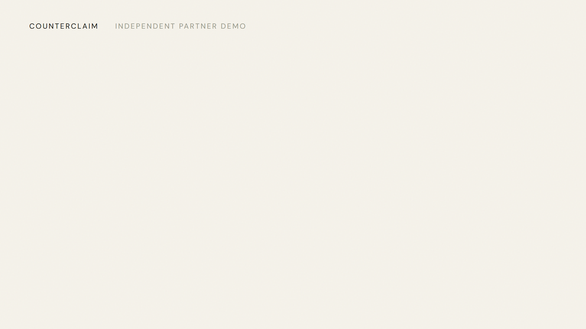

<p align="center">
  
  &nbsp;&nbsp;×&nbsp;&nbsp;
  
  &nbsp;&nbsp;×&nbsp;&nbsp;
  <picture><source media="(prefers-color-scheme: dark)" srcset="media/assets/genlayer-logo-white.svg" /></picture>
</p>

# Counterclaim

**Agree on the work. Authenticate the delivery. Claim without another signature.**

## Version 2 correction — November 24, 2026

The reviewer identified two real limitations in version 1: the relay selected
the pasted artifacts without onchain participant authorization, and a losing
party could prevent the cooperative Yellow close. Version 2 changes the protocol,
not just its description. See the [review response](docs/REVIEWER-RESPONSE-2026-11-24.md).

**Current evidence status:** v2.0.0 has a source-matched Studio deployment, and
77 local tests plus the app build and media typecheck passed on November 24. Separate buyer funding,
seller acceptance and seller delivery have succeeded; the finalized ruling fixes
a 75/25 escrow split. The seller's 0.00075 test-GEN claim finalized, its exact
native transfer and positive net recipient credit were observed, and 0.00025 GEN
remains reserved for the buyer. The buyer made no court call after funding, and
Yellow remained open and unchanged. The November 9 proof files and 42-second film document **version 1**;
they do not demonstrate v2 authorization or GEN escrow. No updated Portal review
decision is claimed.

### The new delivery boundary

The parties expressly agree that the seller's exact onchain UTF-8 text submission
is the digital work being delivered. The buyer fixes the named seller, complete
milestone criteria, weights, deadlines and native GEN deposit. The seller must
independently accept the exact terms hash before submitting the immutable artifact
bundle from that seller address. The relay cannot substitute its own delivery.

This authenticates **which wallet delivered which bytes under which accepted
terms**. It does not prove original authorship, offchain repository ownership,
external hosting, real-world work or successful code execution. Source-code
artifacts receive static source assessment only. These limits are part of the
agreement rather than facts inferred by the jury.

### Native settlement is independent of Yellow

1. The buyer calls payable `open_case(session_id, agreement_json,
   delivery_deadline, refund_after)` and locks the exact GEN value.
2. The named seller calls `accept_case(case_id, expected_terms_hash)`.
3. Only that seller can call `deliver(case_id, evidence_json)` to freeze the
   complete agreed text delivery. Adjudication reads the persisted bundle.
4. Either participant can call `adjudicate(case_id)`. Independent GenLayer
   executions assess the complete criteria and delivery; deterministic code
   derives backed native GEN entitlements from the result.
5. Each participant calls `claim(case_id)` for its own entitlement. The other
   party's signature and a Yellow close are not prerequisites. An EOA transfer
   is scheduled for finalization; the UI must distinguish scheduling from a
   verified finalized payout.
6. If the agreed refund deadline passes without resolution, the buyer may invoke
   `refund_timeout(case_id)` and then claim the agreed refund. Time passing alone
   does not submit that transaction.

Yellow remains an optional two-signature record of the agreement and outcome.
Its token allocations stay empty. A participant may refuse the Yellow mirror;
that refusal cannot veto the separate native GEN claim. The v2 court does not
unlock Yellow-held tokens or bypass Yellow's quorum.

### Reproduce the correction

Use Node.js 24 and Python 3.12+. Work only with disposable Studio accounts and
faucet GEN. The intended reviewer fixture escrows **0.001 test GEN**. It is a
development-network value transfer, not a mainnet payment. A 75/25 split is the
fixture's observed result in the recorded run. Fresh judgments are not forced to
repeat it. Inspect the actual receipt and native transfer evidence.

```sh
git clone https://github.com/zakazaka95/Counterclaim.git
cd Counterclaim
npm ci
npm --prefix server ci
npm --prefix app ci
node scripts/reviewer-demo.mjs
```

The reviewer runner records the actual deployment, separate buyer/seller
authorization transactions, exact delivery, ruling and native claim. It stops on
an unresolved or failed operation rather than creating success evidence. The live
result will be summarized in [LIVE-RESULTS.md](LIVE-RESULTS.md).

The local interface entry points are:

```sh
npm run setup:genlayer
npm start
```

In a second terminal, run `npm --prefix app run dev`, then open
`http://127.0.0.1:5178`. Use **Open demo room**, **Request a ruling**, then
**Claim the escrow awards**. The UI's coordinated two-claim path and the reviewer's
seller-only non-cooperation run are distinct demonstrations. The older cooperative
controls shown in the v1 film do not describe the current native claim path.

### Correction evidence checklist

| Required observation | Current record |
| --- | --- |
| Immutable v2 source commit | [3602e22e30933c41b116b09f7e535cada06578f6](https://github.com/zakazaka95/Counterclaim/blob/3602e22e30933c41b116b09f7e535cada06578f6/contracts/CounterclaimCourt.py) |
| Exact v2 source SHA-256 | `e034dbbf10ccdaaf80125d3e13630837590df2d97da79c212ccce7ca88f44860` |
| Source-matched v2 deployment and schema | [0xC68b67797C630cBBf2bb80D290d68A787c855E14](https://explorer-studio-dev.genlayer.com/address/0xC68b67797C630cBBf2bb80D290d68A787c855E14), version 2.0.0 |
| Buyer funding, separate seller acceptance and seller delivery | Confirmed for case 0; exact transactions in [LIVE-RESULTS.md](LIVE-RESULTS.md) |
| Finalized consensus receipt binding all material state | [0x8680534d…7602995](https://explorer-studio-dev.genlayer.com/tx/0x8680534d17e4df175d22015c69a6d02ccdcb7c65a457d13ac98c4226d7602995); seller 0.00075 / buyer 0.00025 test GEN |
| Native claim without a counterparty or Yellow signature | Seller's [finalized claim](https://explorer-studio-dev.genlayer.com/tx/0x89ddff840170de7316739a4f492a7b7115ff5728efde51524d01526053ed4998); buyer inactive after offer, Yellow unchanged/open at version 2 |
| Actual finalized transfer | 750000000000000 wei to the seller; court balance 1000000000000000 → 250000000000000 wei; recipient net credit 623623999999177 wei after its claim fees |
| Authorization, tamper, duplicate-claim and timeout guards | Covered by passing local tests; no live rejection transactions claimed |
| Updated tests and frontend build | 33 Python + 20 root JS + 17 Yellow + 7 UI tests = 77 passed; app build and media typecheck passed |
| Updated Portal entry | Resubmitted November 24; Pending review, six evidence items and the saved steward response verified |

The local verification commands are:

```sh
python -m unittest discover -s tests -p test_counterclaim.py -v
npm test
npm --prefix server test
npm --prefix app test
npm --prefix app run build
```

Controlled-output tests, live network observations and general jury accuracy are
different kinds of evidence. The passed local checks are not a jury-accuracy
benchmark. The native payout is supported separately by the finalized claim,
external transfer message, court debit and recipient balance observations in
[proof/reviewer-verification-v2.json](proof/reviewer-verification-v2.json).

[Protocol and trust boundaries](ARCHITECTURE.md) ·
[Projects submission and correction copy](docs/PROJECT-SUBMISSION.md) ·
[Optional Yellow adapter](server/README.md)

<details>
<summary>Historical version 1 — cooperative zero-token Yellow demonstration</summary>

Everything in this section describes the November 9, 2026 version 1 run. Its
53-test count, deployment, receipts, 75/25 nonmonetary credits and film remain
historical evidence only. Version 1 did not authenticate the seller's onchain
delivery or release native escrow without both Yellow signatures.

**Version 1: Disagree on the delivery. Agree on what happens next.**

A working Yellow × GenLayer integration using Internet Court's agreement-and-evidence
pattern for the disagreement path in agent-to-agent work. Two synthetic agents freeze their agreement, a real
GenLayer contract reviews the supplied artifacts, and both agents co-sign the
same receipt-bound outcome in a real Yellow sandbox session.

[Watch the 42-second film](demo/counterclaim.mp4) ·
[Inspect the real result](LIVE-RESULTS.md) ·
[Follow the architecture](ARCHITECTURE.md) ·
[Original Partner Demo Lab brief](https://portal.genlayer.foundation/mission/101) ·
[Projects submission record](docs/PROJECT-SUBMISSION.md)



## The case

The seller says the release is complete. The buyer says the tests are missing.
The agreed delivery has three weighted milestones:

| Deliverable | Demo credits | Artifact supplied in this fictional handoff |
| --- | ---: | --- |
| Landing page | 40 | A complete draft meeting its agreed scope. |
| Integration guide | 35 | A complete guide including prerequisites and failure paths. |
| Automated tests | 25 | A status note promising tests later, rather than executable tests. |

The contract must judge each artifact against its **own full natural-language
acceptance criteria**. It does not count files or take the seller's completion
claim as proof. In the recorded run, the persisted consensus result accepted the
first two milestones and rejected the third. Contract code derived **75 seller /
25 buyer demo credits** from the frozen weights.

These supplied case artifacts are separate from this repository's own automated
test suite. The scenario is deliberately synthetic and reproducible.

## What actually runs

- **Yellow SDK 1.4.0:** real sandbox sessions, two isolated signer processes,
  unanimous signatures, versioned updates, live read-back and closure.
- **CounterclaimCourt:** a real deployed GenLayer Intelligent Contract with
  immutable case inputs, full independent receipt validation, bounded technical
  retries and a consequential resolved/inconclusive state.
- **Cooperative relay:** independently re-reads the persisted ruling and verifies
  the exact finalized `adjudicate(case_id)` transaction, caller, target and return
  payload before the proposal can be co-signed.
- **Interface:** inspect the full criteria and artifacts, request a real ruling,
  then co-sign and close. It does not advance into success when an API fails.

Yellow permits at most **1024 UTF-8 bytes** in session data. Its signed metadata
therefore contains full-content SHA-256 commitments and a compact court reference,
not silently shortened evidence. Full inputs live in the GenLayer case and the
public proof. Every accepted Yellow state is read back and compared exactly.

### Deliberate boundary

The **100 demo credits are nonmonetary metadata**. All actual Yellow token
allocations are `[]`; there is no deposit, funded escrow, token payout or real
money movement. Both participants must still sign. A court ruling cannot override
a refusing Yellow participant, and Yellow node liveness is trusted.

GenLayer judges the supplied artifacts; it does not execute their code, authenticate
outside work or provide legal advice. The contract binds the declared Yellow
session but does not independently verify Yellow signatures inside GenVM. The
coordinator and RPC are explicit relay trust boundaries, not a trustless bridge.
This is an independent Partner Demo Lab demonstration.

## Run the real demo locally

Use **Node.js 24** and **Python 3.12+**. No personal wallet, private API key or
mainnet funds are required. The code creates fresh isolated test accounts. Never
put a real wallet key into this demo.

```sh
git clone https://github.com/zakazaka95/Counterclaim.git
cd Counterclaim
npm ci
npm --prefix server ci
npm --prefix app ci
npm run setup:genlayer
npm start
```

Keep that terminal running. In a second terminal:

```sh
cd Counterclaim
npm --prefix app run dev
```

Open **http://127.0.0.1:5178**:

1. Select **Open demo room**. Both test agents sign the agreement and evidence
   commitments into a real zero-token Yellow session.
2. Inspect the three artifacts. Select **Request a ruling**. The coordinator
   opens a matching immutable GenLayer case and waits for actual successful
   adjudication and finalization. This can take a few minutes.
3. Inspect the persisted outcome and Explorer link. An inconclusive ruling has no
   allocation and cannot enable the co-sign action.
4. Select **Co-sign & close room**. The persisted receipt is independently verified
   again; both agents sign the exact proposal, and the closed Yellow version is
   read back. Open **View the complete case timeline** to follow the record.

Alternatively, with the coordinator running and a fresh idle case, `npm run demo`
performs the same three live actions through the API. It does not simulate them.

The default GenLayer endpoint is `https://studio-dev.genlayer.com/api`, chain
**61997**. The runtime refuses another chain ID. A built-in Studio faucet supplies
only test GEN for network fees. Yellow uses
`wss://nitronode-sandbox.yellow.org/v1/ws`. These are development environments and
may be reset or unavailable; a failed call is not displayed as completed work.

### Fresh-clone and recovery behavior

Public `proof/` files are historical evidence, not signing configuration. A fresh
clone generates its own account and deploys its own matching court; it does not
need the original demonstrator's private keys. Active deployment and pending
transaction records stay in ignored `.local/` directories.

Known broadcasts are tracked by the exact operation identity, so retrying a wait
after a timeout resumes the same transaction instead of silently signing again.
Uncertain or failed reviews do not enable settlement. A failed review returns to
an actionable error state; users can retry the tracked operation or start another
zero-token case. If a proposal was applied but closure failed, a retry verifies
that same receipt and resumes closure rather than applying a second proposal.

If a remote update was accepted but its acknowledgement and local record were
lost, the adapter refuses to guess: inspect the live session before continuing.
No recovery path fabricates a signature, receipt or payout.

## Verify the code

```sh
python -m unittest discover -s tests -p test_counterclaim.py -v
npm test
npm --prefix server test
npm --prefix app test
npm --prefix app run build
```

The local suites cover 18 contract logic tests, 12 relay/transaction tests,
17 Yellow adapter tests and 6 UI model tests. They include full receipt-field
tampering, independent semantic disagreement, uncertainty, finality, wrong
transaction/case/caller, retries, authority, Unicode budgets and invalid signatures.
Controlled-output unit tests are separate from the observed live results in
[LIVE-RESULTS.md](LIVE-RESULTS.md); neither is a general AI accuracy benchmark.

The CI workflow runs these local checks without deploying or signing transactions.
The published contract's raw source fingerprint is recorded in `proof/deployment.json`.

## Rebuild the film

The editable Remotion project, official asset provenance, original audio stems,
immutable recorded proof and actual UI captures are in [media/](media/PRODUCTION.md).
All Remotion packages are pinned to the same version.

```sh
npm --prefix media ci
npm --prefix media run typecheck
npm --prefix media run dev
```

The render script uses an explicitly configured compatible headless Chrome; see
`media/PRODUCTION.md` and `media/scripts/render.mjs` for the local browser setting.
The film is 42 seconds, 1920×1080, 30 fps, with original music and sound design.
Chronological captures show the same recorded case and session; waiting is edited
down. All three required official marks are visible. The film never depicts a
funded transfer.

## Sources and licensing

The integration follows the public
[Internet Court skill](https://github.com/internet-court/internet-court-skill),
[Yellow settlement-room skill](https://github.com/layer-3/nitrolite/tree/main/agent-skills/yellow-settlement-room)
and [GenLayer documentation](https://docs.genlayer.com/developers/networks).

Original application, contract and adapter code is MIT licensed. Third-party
brands, typefaces and reused motion components retain their own rights and notices;
see [THIRD-PARTY-NOTICES.md](THIRD-PARTY-NOTICES.md). Logo use identifies the demonstrated
integration and is not an endorsement claim.

</details>
